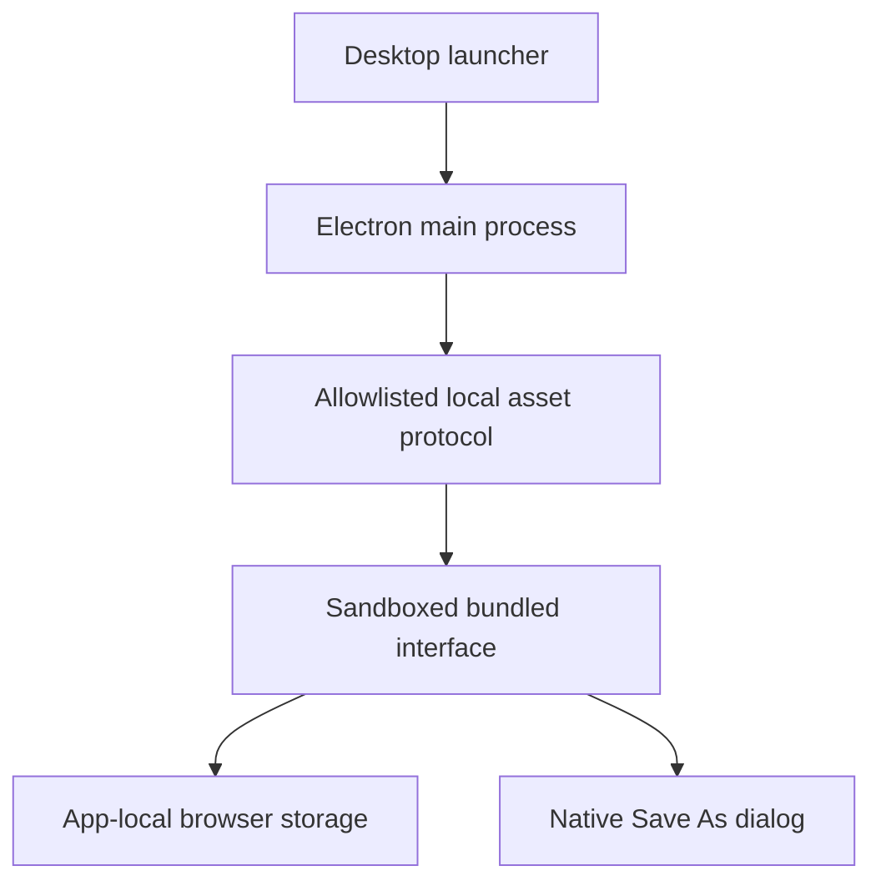

# Desktop packaging plan

## Outcome

Open Untangle from a desktop icon without Node.js, a terminal, a web server or internet access. Keep the existing analysis engine and browser interface unchanged.

## Architecture

Electron loads bundled Vite files through a private `untangle://app` origin. A sandboxed renderer has no Node integration or IPC surface. A small allowlisted protocol handler serves only bundled files with strict CSP and MIME types. External navigation is denied; the single source-code link opens in the system browser after URL validation. Browser storage belongs to the installed app's user-data directory. JSON exports use a native Save As prompt through Electron's download handler.

## Internal patterns

- Adapter: desktop runtime wraps the existing renderer; domain engine unchanged.
- Allowlist: bundled asset paths and external source link are checked before use.
- Single instance: a second launch focuses the existing window.
- Build matrix: build Windows on Windows, macOS on macOS, Linux on Linux.
- Release barrier: publish downloads only after every platform build and its smoke test passes.

## Tasks

1. Add testable asset path resolution and URL policy. Test traversal, unknown hosts, unsupported files and allowed URLs before implementation.
2. Add secure Electron window lifecycle, protocol, local app assets and Save As download handling. Add icon files and installer metadata.
3. Add platform builds (Windows x64 NSIS + portable; Linux x64 AppImage + deb; macOS x64 + arm64 dmg + zip). Set relative Vite asset base.
4. Smoke-test each unpacked native app in CI, then assemble all artifacts and SHA256 checksums into a GitHub release. Test domain engine, strict typing and production build before packaging.

## Limits

Release is unsigned and macOS is not notarized because no signing credentials are available. Document OS prompts honestly. No updater or privileged filesystem bridge is introduced. Data persists between ordinary launches and upgrades, but export is needed for backups and transfers; analysed source, not unsaved edits, is saved.
