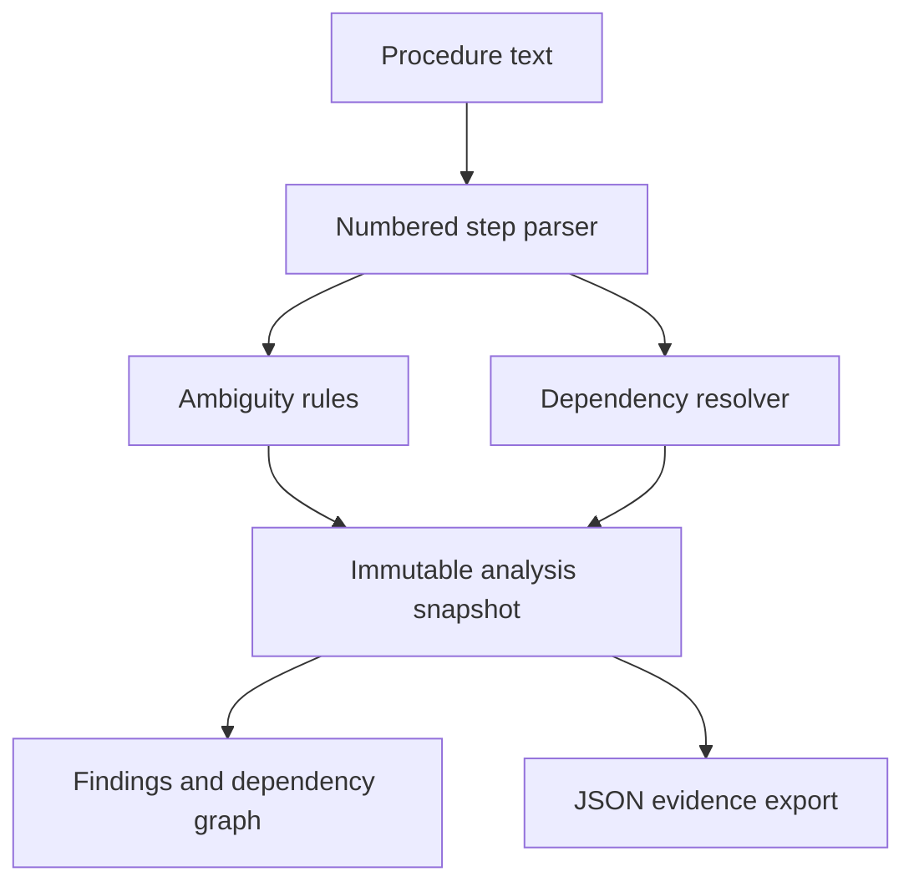
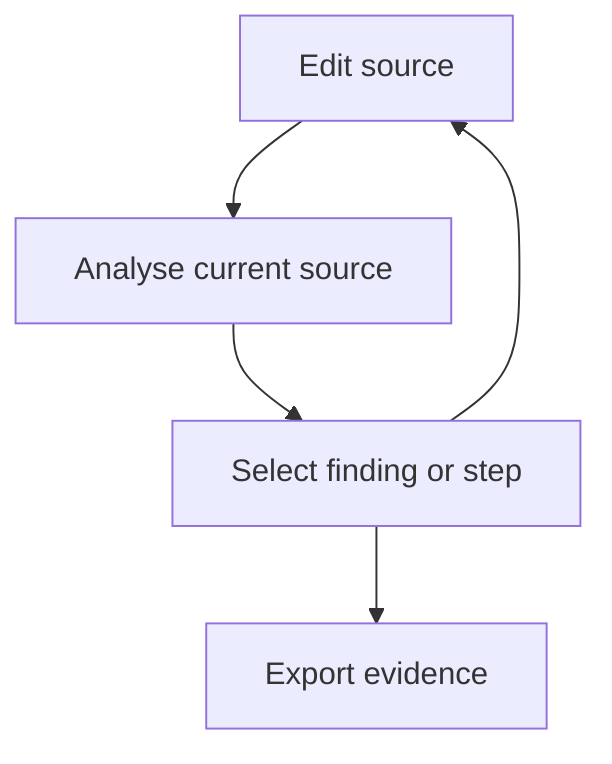

# Untangle implementation plan

Goal: make ambiguity visible in technical procedures, with evidence and a navigable dependency graph.

User direction: aerospace-inspired technical English, ambiguity flags, procedural dependencies. Execute the plan and build in this session.

## Design

A local-first, single deployable application. A pure TypeScript domain engine has no browser dependencies. React owns presentation. Storage and export are adapters. No server, credentials, document uploads, or generated rewrite is needed. Rules are transparent heuristics inspired by controlled-language principles, not a complete ASD-STE100 implementation or certification.

## Internal design patterns

| Pattern                     | Implementation                                                       | Reason                                         |
| --------------------------- | -------------------------------------------------------------------- | ---------------------------------------------- |
| Ports and adapters          | Pure `analyse(text)`; browser persistence/export adapters            | Engine runs in tests or another host           |
| Rule strategy               | Independent rule records with match, explanation, remedy             | Rules can change without graph/UI changes      |
| Immutable analysis snapshot | Versioned result from each analysis                                  | Exports identify the source and engine version |
| Explicit provenance         | Each finding has source offsets and rule ID; every edge has a reason | Users can inspect evidence                     |
| Derived view model          | Graph and counts derived from the same snapshot                      | No independently stale analytics               |
| Untrusted-input boundary    | Render source as text; bound length; validate storage                | Pasted content cannot become HTML              |

## Graph semantics

A node is one parsed step. Solid edges are explicit references such as `after step 2`. Dashed edges mean document order only, not a proven physical prerequisite. Missing references are findings. Cycles are detected on explicit edges only. Conditional language is retained on nodes; it is not converted into invented branch semantics. Free prose becomes one step per nonempty line. Duplicate step numbers are rejected.

## Tasks

1. Domain engine (`src/engine.ts`, `tests/engine.test.ts`): tests first for vague language, pronouns, conjunctions, passive wording, explicit references, cycles, duplicate numbering, offsets, empty input, text limits, and deterministic output. Run `npm test` before and after implementation.
2. Workbench (`src/App.tsx`, `src/Graph.tsx`, `src/styles.css`): editable examples, explicit analysis, source selection, severity filter, graph selection, unsaved-change indication, local persistence and JSON export. Graph provides a text edge list and keyboard-accessible steps. Narrow layouts stack panels.
3. Delivery (`README.md`, workflow, `docs/WORK_LOG.md`): typecheck, tests, production build, browser interaction and responsive checks; commit and publish repository files.

## Review focus

- Text containing HTML stays inert.
- Edits never silently retain apparently current analysis.
- Inferred order never appears as a verified requirement.
- Broken or unavailable local storage does not block analysis.
- Large input is bounded and empty input produces a usable empty state.

## Visual system

Dark navy engineering workbench, mint primary action, orange findings, legible sans-serif interface and monospace source, three desktop regions (source, graph, inspector). Mobile uses one column. SVG graph is code-native exact data, not generated artwork.

## Sources

- https://www.asd-ste100.org/about_STE.html — controlled-language context; no dictionary is redistributed.
- https://www.aalpha.net/blog/backend-architecture-scalable-secure-systems/ — supplied architecture discussion; modularity and separation are applied without distributed infrastructure.

## Acceptance

All engine tests pass, strict TypeScript and production build pass, main workflow operates in a browser, no external service is required at runtime. Parser/rule limits are documented. This prototype is an authoring aid, not an aircraft maintenance procedure validator.
