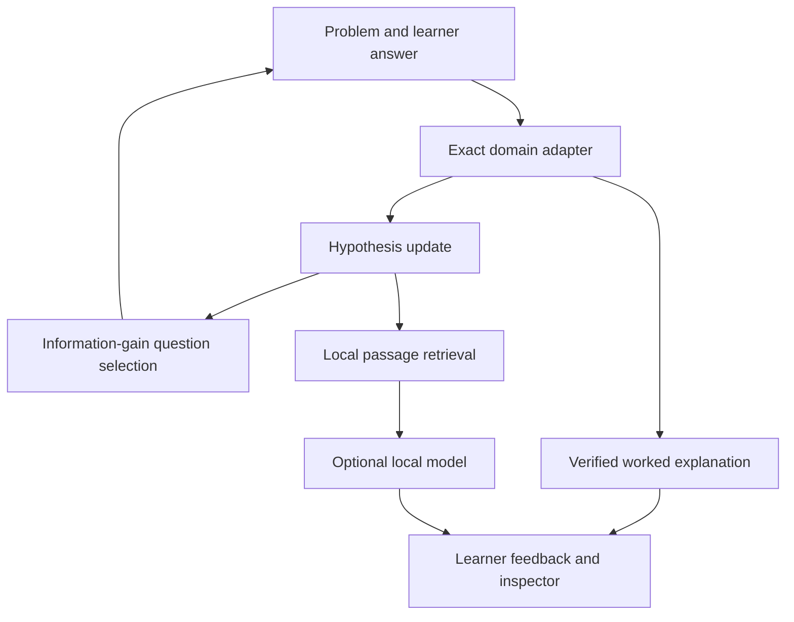

# Learning architecture

Pure typed domain modules supply tasks, exact answers and candidate strategy predictions. A shared Bayesian engine computes expected information gain over a generated candidate pool. The renderer owns interaction and visualisation. A retrieval module ranks local source passages using lexical BM25-style scoring. Desktop AI is an opt-in, sandbox-separated adapter with narrow IPC and loopback-only networking.

## Internal design patterns

| Pattern             | Contract                                                                                 |
| ------------------- | ---------------------------------------------------------------------------------------- |
| Strategy adapters   | Domain produces predicted answers for each hypothesis                                    |
| Functional core     | Rational arithmetic, task generation and inference have no UI/process access             |
| Evidence snapshot   | Response events retain task, answer and posterior; import reconstructs events            |
| Ports/adapters      | Knowledge documents and local inference are replaceable behind typed interfaces          |
| Residual hypothesis | Unmodelled answers retain a plausible alternative; no zero likelihoods                   |
| Least privilege     | Renderer cannot launch executables or read arbitrary files; native dialogs select inputs |

## Equations

For hypotheses h and response bucket r, likelihood is 0.9 for the predicted bucket plus 0.1/K across all K buckets. The residual hypothesis is uniform across buckets. Rationally equivalent answers share a bucket; all other answers map to OTHER.

P(h | r,q) = P(r | h,q)P(h) / sum_h P(r | h,q)P(h).
H(p) = -sum_h p(h) log2 p(h).
IG(q) = H(p) - sum_r P(r | q) H(P(h | r,q)).

Question selection excludes previously seen canonical task IDs and chooses maximum IG with deterministic tie-breaking. These likelihoods are authored modelling assumptions; scores are not empirically calibrated diagnostic confidence. The system models short-session strategy consistency, not skill acquisition.

## Local AI trust boundary

A sandboxed preload exposes status, select/start, stop and explain. The main process validates the sender, argument sizes and files, then starts the chosen executable with shell=false, a reserved local port, 4096-token context and loopback binding. Prompts contain retrieved text as untrusted evidence. Generated prose is labelled and cannot modify exact answers, hypothesis weights, or stored sources. The server process belongs to Untangle and is stopped on quit.
