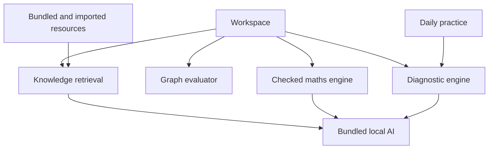

# Untangle v0.4 — Integrated maths workspace
Status: Proposed architecture for user review. No v0.4 product code or model bundle has shipped.
Date: 2026-10-15

## Agreed goal
A desktop app that works immediately after installation: built-in offline AI, a useful preloaded searchable knowledge library, daily practice, calculation and interactive graphing. Preserve the original diagnostic question loop and clear correct/incorrect feedback. The user selected an approximately 1–2 GB complete download target.

## Product design
One workspace with a prominent input supporting problems and questions. Navigation: Solve, Graph, Learn, Library, Today.
- Solve: checked results and worked steps for explicitly supported forms, with send-to-graph and practise actions.
- Graph: editable expression list beside a Cartesian graph; pan, zoom, points, multiple functions and named parameter sliders. Initially 2D Cartesian functions, not implicit/3D/geometry parity.
- Learn: learner answer, exact verdict, common-mistake guidance, adaptive follow-ups and transfer questions. Do not replace this with an answer-only chatbot.
- Library: populated offline from installation; search ordinary questions, mathematical notation, titles and topic names. Filters for topic, level and source. Results open complete resource entries; grounded AI answers cite retrievable entries.
- Today: three questions per local calendar day: review, current-level practice and challenge. Save attempts and completion locally; solutions after an attempt. No duplicate credit on relaunch. Practice is optional, without a punitive streak.
- Shared AI panel: explain a result, clarify a passage, or ask a follow-up. Distinguish checked calculation, retrieved source evidence and generated prose.

## Source-to-workspace mapping
| Reference | Adopted interaction | Untangle destination |
| --- | --- | --- |
| WolframAlpha | prominent maths/natural-language input, structured answer panels | Solve |
| Desmos graphing | expression list, graph, parameter sliders | Graph |
| Untangle v0.3.1 | explicit verdict, competing methods, selected follow-ups | Learn |
| Existing local library | imports and preserved source references | Library |
| Practice dashboard pattern | short daily set and progress | Today |

Use the cloner template's map → observe → build → compare process as a workflow reference. Preserve Electron/React/Vite instead of migrating to a server-dependent Next.js architecture. Use original Untangle branding and UI assets. Capture desktop/mobile reference states before final visual implementation; no rendered comparison has been done in this design step.

## Architecture

Pure domain services remain separate from presentation. A typed router returns calculate, graph, retrieve or diagnose intent. Natural-language interpretations are shown before execution when ambiguous. Unsupported requests must say so. A model cannot execute JavaScript, modify files, invent solver capability or silently change verified answers.

### Bundled AI
- Complete installers include a CPU-capable llama.cpp runtime plus compatible quantised GGUF weights and redistribution notices. No API key, executable picker, model picker or first-run network download in the default flow.
- Evaluate Qwen3-1.7B Q4-class GGUF as the initial candidate against the existing 0.6B baseline; final artefact/version/hash depends on actual latency, memory, size, quality and licence verification. Target is 1–2 GB overall, not a guaranteed measured result.
- Store model/runtime outside asar via extraResources; separate platform/architecture runtime manifests, SHA-256 checks, dependency inventory and licences. Never commit model binaries to Git.
- Load on the first AI request; keep the UI responsive, allow cancel, shut down on exit, handle missing/corrupt assets and low-memory failure. Local-only authenticated transport, no renderer Node access.
- Native release checks must run actual bundled inference with networking disabled on all four platforms. Checking that an IPC function exists is insufficient.
- Arithmetic stays independent of generated text. AI output uses the supplied checked result and retrieved evidence; source links must resolve to supplied entries. Do not claim this prevents all hallucinations.

### Search and library
- Replace a handful of snippets with a versioned starter collection: at least 60 complete original teaching entries across the nine existing maths areas and code tracing, with prerequisites, worked examples, common mistakes and links to practice.
- Include source ID, stable entry/section ID, topic, level, provenance, licence and version. Original Untangle content is marked as authored; external claims cite their sources.
- Bundle original resources first. Add external full text only after checking the exact edition's licence and retaining required attribution. Search results about OpenStax licensing conflict across editions; do not assume every book permits commercial redistribution.
- Hybrid lexical and local semantic retrieval, with a bundled small embedding model included in the download budget. Use lexical fallback if semantic inference is unavailable, and label it accurately.
- Query normalisation handles mathematical synonyms and notation; rank sources, deduplicate overlapping chunks, filter by topic/level and show snippets plus full-entry navigation.
- Retrieve before generate. Empty/weak matches produce an explicit insufficient-evidence message. Imported PDF/TXT/Markdown sources remain inert and separate from bundled material.
- Evaluation uses held-out student-style queries and irrelevant distractors, including spelling variations, symbol queries and no-answer cases.

### Maths and graphing
- Integrate a maintained expression/parser library only after checking its licence, restricted evaluation surface and worker compatibility. Never eval/new Function arbitrary text.
- Bounded scientific arithmetic and 2D functions first: powers, parentheses, trig, exponentials, logs, constants and parameter sliders.
- Retain exact rational arithmetic for existing diagnoses. Numeric plots display approximation; symbolic operations expose explicit supported forms.
- Run expensive evaluation in a cancellable worker with expression/operation/sample budgets. Break curves at discontinuities and exclude non-finite points.
- Save graph expressions, parameter ranges and viewport. Export sessions without embedding huge model files.

### Daily questions
- In-app functionality, not an external reminder automation.
- Deterministic question seed uses local date, topic and question-bank version. Persist the assigned set before attempts so progress changes cannot replace today's questions.
- Use prior attempts to pick review areas where available; give a balanced beginner set without history. Generated parameters have independent checked answers.
- Explain wrong answers, offer support, then a new transfer question. Track attempted/correct/completed separately.
- Cover date rollover, restart, timezone changes, duplicate submissions and absent storage.

## Verification and release acceptance
1. Fresh installation on Windows/Linux/Intel Mac/Apple Silicon needs no tools or downloads to run an actual AI explanation offline.
2. Artefact manifests record exact runtime/model hashes, licences, installer bytes, cold/warm response latency and peak memory on named hosts.
3. Original fraction example still distinguishes a verdict from an uncertain diagnosis; equivalent answers remain correct.
4. At least 60 bundled full entries searchable before any import. Held-out retrieval report includes relevance and abstention results; lexical fallback is visible.
5. Graph tests cover x^2, sin(x), y=a*x+b with sliders, 1/x without connecting across its pole, invalid/hostile expressions and resource limits.
6. Today survives restart, keeps assigned questions fixed, gives no duplicate completion credit and rolls over by local date.
7. Keyboard navigation, readable maths, responsive layouts, cancelled AI, denied storage, imports, export/replay and existing app features pass browser/native checks.
8. Publish a new version only after all native packaging, inference and workflow checks pass. Existing v0.3.1 downloads stay available.
9. Release notes list actual supported maths forms and measured model limits; no WolframAlpha/Desmos feature-parity claim.

## Proposed build sequence
1. Reference inspection and shared workspace shell; preserve existing learning routes.
2. Resource schema, starter corpus and retrieval evaluation; add semantic indexing.
3. Restricted calculation and graph worker with linked UI and tests.
4. Daily assignment and attempt persistence using existing domain packs.
5. Bundled model/runtime preparation, integrated AI UI and measured quality/performance trials.
6. Integrated offline QA, migration/export tests and four-platform release.

This sequence is a design outline, not the detailed implementation plan. User review of this spec precedes the detailed plan and implementation.

## References checked
- https://github.com/JCodesMore/ai-website-cloner-template
- https://github.com/JCodesMore/ai-website-cloner-template/blob/master/.agents/skills/clone-website/SKILL.md
- https://www.wolframalpha.com/
- https://www.desmos.com/
- https://help.desmos.com/hc/en-us/articles/202529069-Sliders-and-Movable-Points-in-a-Graph
- https://huggingface.co/Qwen/Qwen3-1.7B-GGUF
- https://huggingface.co/ggml-org/Qwen3-1.7B-GGUF
- https://help.openstax.org/s/article/Openstax-textbook-licensing-and-customization
